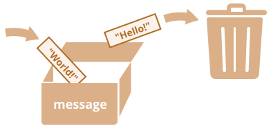

# Muuttujat

JavaScript ohjelmien täytyy useimmiten käsitellä tietoa. Tässä on kaksi esimerkkiä:
1. Verkkokauppa -- tiedot voisivat sisältää myytäviä tuotteita ja ostoskorin.
2. Chat sovellus -- tiedot voisivat sisältää käyttäjiä, viestejä ja paljon muuta.

Näiden tietojen varastoimiseen käytetään muuttujia.

## Muuttuja

[Muuttuja](https://fi.wikipedia.org/wiki/Muuttuja_(ohjelmointi)) on nimetty tietovarasto tiedolle. Voimme käyttää muuttujia varastoimaan kaupan hyödykkeitä, vierailijoita ja muuta dataa.

Luodaksesi muuttujan JavaScriptissa, käytä avainsanaa `let`.

Alla oleva lauseke luo (toisin sanoen: *esittelee*) muuttujan, jonka nimi on "message":

```js
let message;
```

Voimme nyt varastoida siihen tietoja käyttämällä sijoitus operaattoria `=`:

```js
let message;

*!*
message = 'Hello'; // varastoidaan merkkijono 'Hello' muuttujaan nimeltä message
*/!*
```

Merkkijono on nyt varastoitu muistin osaan, joka on liitetty muuttujaan. Pääsemme siihen käsiksi muuttujan nimen avulla:

```js run
let message;
message = 'Hello!';

*!*
alert(message); // näyttää muuttujan sisällön
*/!*
```

Tiiviyden vuoksi voimme yhdistää muuttujan esittelyn ja arvon sijoituksen yhteen riviin:

```js run
let message = 'Hello!'; // esitellään muuttuja ja sijoitetaan arvo

alert(message); // Hello!
```

Voimme myös esitellä useamman muuttujan yhdellä rivillä:

```js no-beautify
let user = 'John', age = 25, message = 'Hello';
```

Tuo näyttää lyhyemmältä, mutta emme suosittele sitä. Paremman luettavuuden vuoksi kannattaa käyttää yhtä riviä per muuttuja.

Monirivinen versio on vähän pidempi, mutta se on helpompi lukea:

```js
let user = 'John';
let age = 25;
let message = 'Hello';
```

Jotkut ihmiset esittelevät useampia muuttujia myös tällä monirivisellä tyylillä:

```js no-beautify
let user = 'John',
  age = 25,
  message = 'Hello';
```

...Tai jopa "pilkku ensin" tyylillä:

```js no-beautify
let user = 'John'
  , age = 25
  , message = 'Hello';
```

Teknisesti kaikki nämä vaihtoehdot tekevät saman asian. On siis kyse lähinnä henkilökohtaisista mieltymyksistä ja estetiikasta. 

````smart header="`var` instead of `let`"
Vanhemmissa skripteissä saattaa esiintyä myös `var` avainsana `let`:n sijaan:

```js
*!*var*/!* message = 'Hello';
```

Tämä `var` avainsana on *lähes* sama asia kuin `let`. Myös se esittelee muuttujan, mutta vähän erilaisella, "vanhanaikaisella" tavalla.

Avainsanojen `let` ja `var` välillä on pieniä eroja, mutta ne eivät vielä vaikuta meihin. Käsittelemme niitä yksityiskohtaisesti kappaleessa <info:var>.
````

## Tosielämän analogia

On helpompi ymmärtää "muuttuja" käsite, jos kuvittelemme sen olevan "laatikko" datalle, jossa on uniikki nimitarra.

Esimerkiksi muuttuja `message` voidaan kuvitella laatikoksi, joka on merkattu `"message"` tarralla ja jonka sisällä on arvo `"Hello!"`:


Voimme laittaa laatikkoon minkä tahansa arvon.

Voimme myös muuttaa sitä niin usein kuin haluamme:

```js run
let message;

message = 'Hello!';

message = 'World!'; // arvo muuttuu

alert(message);
```

Kun arvoa muutetaan, vanha data poistetaan muuttujasta:



Voimme myös esitellä kaksi muuttujaa ja kopioida dataa niiden välillä.

```js run
let hello = 'Hello world!';

let message;

*!*
// kopioidaan 'Hello world' hello-muuttujasta message-muuttujaan
message = hello;
*/!*

// nyt kahdessa muuttujassa on sama arvo
alert(hello); // Hello world!
alert(message); // Hello world!
```

````warn header="Kahdesti esitteleminen aiheuttaa virheen"
Muuttujan voi esitellä vain kerran.

Saman muuttujan esitteleminen useamman kerran aiheuttaa virheen:

```js run
let message = "This";

// toistuva 'let' johtaa virheeseen
let message = "That"; // SyntaxError: 'message' has already been declared
```
Meidän pitää siis esitellä muuttuja kerran ja sen jälkeen viitata siihen ilman `let` avainsanaa.
````

```smart header="Funktionaaliset kielet"
On mielenkiintoista huomata, että on olemassa niin sanottuja [puhtaasti funktionaalisia](https://en.wikipedia.org/wiki/Purely_functional_programming) ohjelmointikieliä, kuten [Haskell](https://fi.wikipedia.org/wiki/Haskell), jotka kieltävät muuttujien arvojen muuttamisen.

Tällaisissa kielissä "laatikkoon" varastoitu arvo on siellä ikuisesti. Jos meidän täytyy varastoida jotain muuta, kieli pakottaa meidät luomaan uuden laatikon (esittelemään uuden muuttujan). Vanhaa ei voida käyttää uudelleen.

Vaikka tämä vaikuttaa ensisilmäyksellä hieman oudolta, näillä kielillä voi hyvin tehdä vakavaa sovelluskehitystä. Lisäksi on alueita, kuten rinnakkaislaskenta, joilla tästä rajoituksesta on tiettyjä etuja.
```

## Muuttujien nimeäminen [#variable-naming]

JavaScriptissa on kaksi rajoitusta muuttujien nimille:

1. Nimen täytyy sisältää vain kirjaimia, numeroita tai merkkejä `$` ja `_`.
2. Ensimmäinen merkki ei saa olla numero.

Esimerkkejä pätevistä nimistä:

```js
let userName;
let test123;
```

Kun nimi sisältää useampia sanoja, käytetään yleensä [camelCasea](https://fi.wikipedia.org/wiki/CamelCase). Eli: sanat kirjoitetaan peräkkäin niin, että kaikki paitsi ensimmäinen alkaa isolla kirjaimella: `minunTosiPitkaNimi`.

On mielenkiintoista, että dollarimerkkiä `'$'` ja alaviivaa `'_'` voidaan käyttää nimissä. Ne ovat tavallisia symboleita samoin kuin kirjaimet, eikä niillä ole erityistä merkitystä.

Nämä nimet ovat päteviä:

```js run untrusted
let $ = 1; // esittelee muuttujan nimellä "$"
let _ = 2; // ja nyt muuttujan nimellä "_"

alert($ + _); // 3
```

Esimerkkejä vääristä nimistä:

```js no-beautify
let 1a; // ei voi alkaa numerolla

let my-name; // viivoja '-' ei sallita
```

```smart header="Kirjainkoolla on merkitystä"
Muuttujat `apple` ja `APPLE` ovat kaksi eri muuttujaa.
```

````smart header="Ei-latinalaiset kirjaimet ovat myös sallittuja, mutta niitä ei suositella"
On mahdollista käyttää mitä tahansa kieltä, mukaan lukien kyrillisiä kirjaimia, kiinalaisia logogrammeja ja niin edelleen, tähän tapaan:

```js
let имя = '...';
let 我 = '...';
```

Teknisesti tässä ei ole virhettä. Tällaiset nimet ovat sallittuja, mutta kansainvälinen käytäntö on käyttää muuttujien nimissä englantia. Pienelläkin skriptillä voi olla pitkä elämä edessään. Muista maista tulevien ihmisten voi joskus olla tarpeen lukea sitä.
````

````warn header="Varatut nimet"
On olemassa [lista varatuista sanoista](https://developer.mozilla.org/en-US/docs/Web/JavaScript/Reference/Lexical_grammar#Keywords), joita ei voida käyttää, koska niitä käytetään kielessä itsessään.

Esimerkiksi `let`, `class`, `return`, ja `function` ovat varattuja.

Alla oleva koodi antaa syntaksivirheen:

```js run no-beautify
let let = 5; // muuttujan nimi ei voi olla "let", virhe!
let return = 5; // se ei voi olla myöskään "return", virhe!
```
````

````warn header="Sijoitus ilman `use strict` komentoa"

Tavallisesti meidän pitää esitellä muuttuja ennen sen käyttöä. Ennen vanhaan oli periaattessa mahdollista luoda muuttuja ihan vaan sijoittamalla arvo ilman, että käytti `let` avainsanaa. Tämä toimii edelleen, jos emme sijoita `use strict` komentoa skripteihimme, jotta yhteensopivuus vanhojen skriptien kanssa säilyy.

```js run no-strict
// huom: ei "use strict" komentoa

num = 5; // muuttuja "num" luodaan, jos sitä ei ole olemassa

alert(num); // 5
```

Tämä on huono tapa ja aiheuttaisi virheen strict tilassa:

```js
"use strict";

*!*
num = 5; // error: num is not defined
*/!*
```
````

## Vakiomuuttujat

Vakiomuuttujan (ei muutu) voi esitellä käyttämällä `const` avainsanaa `let` avainsanan sijasta:

```js
const myBirthday = '18.04.1982';
```

Muuttujia, jotka esitellään `const` avainsanalla kutsutaan "vakiomuuttujiksi". Niiden arvoa ei voida sijoittaa uudelleen. Yrittäminen aiheuttaisi virheen:

```js run
const myBirthday = '18.04.1982';

myBirthday = '01.01.2001'; // Error, can't reassign the constant!
```

Kun ohjelmoija on varma, ettei muuttujan arvo koskaan muutu, hän voi esitellä sen `const`-avainsanalla. Näin arvon pysyvyys varmistetaan ja siitä viestitään kaikille.

### Isokirjaimiset vakiomuuttujat

On laajalle levinnyt käytäntö käyttää vakiomuuttujia aliaksina vaikeasti muistettaville arvoille, jotka tunnetaan ennen koodin suorittamista.

Tällaiset vakiot kirjoitetaan suurten kirjainten ja alaviivojen avulla.

Luodaan esimerkiksi vakioita väreille niin sanotussa "web" (heksadesimaali) muodossa:

```js run
const COLOR_RED = "#F00";
const COLOR_GREEN = "#0F0";
const COLOR_BLUE = "#00F";
const COLOR_ORANGE = "#FF7F00";

// ...kun meidän tarvitsee valita väri
let color = COLOR_ORANGE;
alert(color); // #FF7F00
```

Hyödyt:

- `COLOR_ORANGE` on paljon helpompi muistaa kuin `"#FF7F00"`.
- On paljon helpompi kirjoittaa väärin `"#FF7F00"` kuin `COLOR_ORANGE`.
- Kun koodia lukee, `COLOR_ORANGE` on paljon kuvaavampi kuin `#FF7F00`.

Milloin käytämme suuria kirjaimia ja milloin nimeämme vakiot normaalisti? Tehdään siitä selvää.

Termillä "vakio" tarkoitetaan vain sitä, että muuttujan arvo ei koskaan muutu. On kuitenkin vakioita, jotka tunnetaan ennen koodin suoritusta (kuten värin punainen heksadesimaaliarvo) ja vakioita, jotka *lasketaan* koodin suorituksen aikana, mutta ne eivät muutu ensimmäisen arvon sijoituksen jälkeen.

Esimerkiksi:

```js
const pageLoadTime = /* aika, joka kuluu nettisivun lataamiseen */;
```

Muuttujan `pageLoadTime` arvoa ei tunneta ennen sivun lataamista, joten se kirjoitetaan normaalisti. Se on silti vakio, koska sen arvo ei muutu sijoittamisen jälkeen.

Toisin sanoen isoilla kirjaimilla kirjoitettuja vakiomuuttujia käytetään vain "kovakoodattujen" arvojen aliaksina.

## Oikeaoppinen nimeäminen

Muuttujista puhuttaessa on vielä yksi erittäin tärkeä asia.

Nimellä pitäisi olla selkeä, itsestäänselvä tarkoitus, joka kuvaa sen varastoimaa dataa.

Muuttujien nimeäminen on yksi tärkeimmistä ja vaikeimmista taidoista ohjelmoinnissa. Nopea muuttujien nimien vilkaisu voi paljastaa, minkä koodin on kirjoittanut aloittelija ja minkä kokenut sovelluskehittäjä.

Oikeassa projektissa suurin osa ajasta käytetään olemassa olevan koodin muokkaamiseen ja jatkamiseen sen sijaan, että kirjoitettaisiin jotain täysin tyhjästä. Kun palaamme koodin ääreen tehtyämme jotain muuta vähän aikaa, on paljon helpompi löytää tietoa, joka on merkitty hyvin. Toisin sanoen, kun muuttujilla on hyvät nimet.

Käytäthän aikaa hyvän muuttujan nimen keksimiseen ennen kuin esittelet sen. Tämä maksaa itsensä takaisin komeasti.

Muutamia hyviä sääntöjä:

- Käytä nimiä, jotka ihminen ymmärtää kuten `userName` tai `shoppingCart`.
- Vältä lyhenteitä ja lyhyitä nimiä kuten `a`, `b` ja `c`, jollet todella tiedä mitä olet tekemässä.
- Tee nimistä maksimaalisen kuvaavia ja tiiviitä. Esimerkkejä huonoista nimistä ovat `data` ja `value`. Tällaiset nimet eivät kerro mitään. Niiden käyttäminen on okei vain silloin, kun koodin konteksti tekee erityisen itsestäänselväksi, mihin dataan tai arvoon muuttuja viittaa.
- Sovi termeistä tiimisi kesken ja omassa mielessäsi. Jos sivuston vierailijaa kutsutaan nimellä "user", siihen liittyvät muuttujat kannattaa nimetä `currentUser` tai `newUser` eikä `currentVisitor` tai `newManInTown`.

Kuulostaa yksinkertaiselle? Se todellakin on, mutta kuvaavien ja tiiviiden muuttujien nimien keksiminen käytännössä ei ole helppoa. Anna palaa.

```smart header="Uudelleenkäyttö vai uuden luominen?"
Viimeinen huomio. On paljon laiskoja ohjelmoijia, joilla on tapana käyttää uudelleen olemassa olevia muuttujien nimiä uusien luomisen sijaan.

Tämän tuloksena, heidän muuttujansa ovat kuin laatikoita, joihin ihmiset heittelevät erilaisia asioita ilman, että niiden nimitarroja muutetaan. Mitä laatikossa on nyt? Meidän on katsottava lähemmin ja tarkistettava.

Tällaiset ohjelmoijat säästävät hieman aikaa muuttujien esittelyssä, mutta menettävät kymmenenkertaisen määrän aikaa virheenetsinnässä ja -korjauksessa.

Uusi muuttuja on hyvä, ei paha asia.

Nykyaikaiset JavaScriptin minimoijat ja selaimet optimoivat koodia tarpeeksi hyvin, joten se ei aiheuta suorityskykyongelmia. Eri muuttujien käyttö eri arvoille voi jopa auttaa moottoria optimoimaan koodisi.
```

## Tiivistelmä

Voimme esitellä muuttujia varastoidaksemme dataa käyttämällä `var`, `let` tai `const` avainsanoja.

- `let` -- on nykyaikainen muuttujan esittely.
- `var` -- on vanhanaikainen muuttujan esittely. Tavallisesti emme käytä sitä ollenkaan, mutta käsittelemme sen pieniä eroja `let` avainsanaan kappaleessa <info:var> siltä varalta, että tarvitset sitä
- `const` -- on kuin `let`, mutta sen arvoa ei voida muuttaa.

Muuttujat pitää nimetä niin, että ymmärrämme helposti, mitä ne sisältävät.
